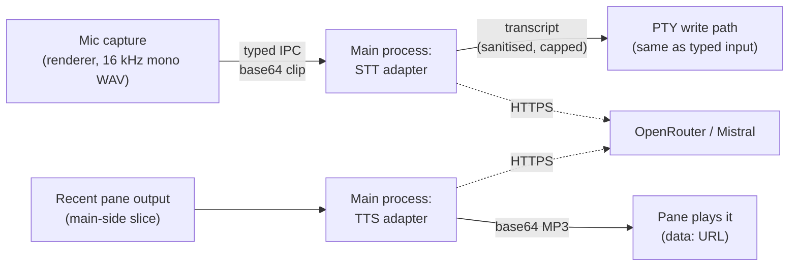

# Voice dictation and readback

Push-to-talk dictation and on-demand read-aloud for terminal tabs. Two controls live in each tab strip's header, beside Find and Save, and appear once the tab has a live session:

- **Dictate** — click to start recording; a pulsing dot marks the recording state. Click again to stop: the clip is transcribed and the transcript is inserted into the tab it was recorded in, exactly as typed keystrokes would be. The OS microphone prompt fires once, on first use. If the tab's controls disappear mid-recording — you switch column, open the Dashboard band, or close the tab — the recording is cancelled and the microphone released immediately.
- **Read** — click to have the tab's recent output read aloud; click again (or start a new read) to stop. It never speaks unprompted.

Both stay idle until clicked. Nothing records unless Dictate is toggled on.

## How it works

- **Recording** happens in the renderer (echo cancellation + noise suppression on); **provider calls happen only in the main process** — the renderer never talks to the network, and key values are used only in the main process (a key entered in Settings is displayed back by the Settings prefill, the same shape as the dashboard's `apiKey`).
- The transcript is sanitised before insertion: control characters (a stray Ctrl-C, EOF), carriage returns, and ANSI escape sequences are stripped, and the text is capped at 4000 characters. An empty transcript is a visible no-op notice, never a silent write of nothing.
- The write goes through the same terminal-service path as typed input (`termWrite`), so multi-line transcripts submit per line, exactly as if typed.
- Read-aloud reads the tab's **recent output** — the same recent-scrollback slice the Dashboard summarizer uses. It is not a parsed "final answer": on a full-screen TUI tab it reads whatever the cleaned buffer holds.

## Providers and keys

OpenRouter is the first provider; Mistral is the fallback when OpenRouter has no key or fails. Endpoints and models (verified 2026-10-11):

| | Transcription | Speech |
|---|---|---|
| OpenRouter | `POST /api/v1/chat/completions` with an `input_audio` part, model `mistralai/voxtral-small-24b-2507` | `POST /api/v1/audio/speech`, model `mistralai/voxtral-mini-tts-2603`, voice `en_paul_neutral`, `response_format: mp3` |
| Mistral | `POST /v1/audio/transcriptions` (multipart), model `voxtral-mini-latest` | `POST /v1/audio/speech`, model `voxtral-mini-tts-2603`, `voice_id` required |

Keys resolve in this order:

1. `~/.config/agents/.env` (read-only) — `OPENROUTER_API_KEY` and `MISTRAL_API_KEY`. This is the default source; nothing to configure.
2. **Settings → Voice** (under *Personal · this machine*) — the manual fallback for machines without the env file. Keys are stored in the per-machine `settings.json` only, never in a tree's settings file, and are never logged; they are used only in the main process for provider calls (a settings-entered key is displayed back by this Settings prefill).

The Mistral TTS fallback additionally needs a **Mistral voice id** (`voice.mistralVoiceId`): Mistral's speech API has no anonymous preset voice. Without one the fallback is skipped with a clear message and read-aloud relies on OpenRouter alone. Transcription and OpenRouter speech work with just the env file.

The OpenRouter TTS voice id carries the language in its prefix — `en_paul_*`, `gb_jane_*`, `fr_marie_*` — pick another under Settings → Voice if you dictate in French (`fr_marie_neutral`).

## Privacy

- A clip leaves the machine **only while you are recording, only once, on stop**, and only to the configured speech provider. condash keeps no copy of clips or audio, and nothing records unless Dictate is toggled on.
- Read-aloud sends the tab's recent output **text** to the TTS provider when you click Read. As with the Dashboard: leave it off for tabs that display credentials you don't want transmitted.
- The mic permission handler is scoped to the app's own window contents — no embedded `<webview>` or other contents can open the microphone through condash. Every other permission class passes through untouched, keeping Electron's no-handler default (auto-approve) — denying them broke the Resources pane's clipboard read.

## Settings reference

Every field is optional; the full per-key reference lives in [Config files → Voice](../reference/config.md#voice).

| Setting | Default | Meaning |
|---|---|---|
| OpenRouter API key | — (env file) | Manual key when the env file is missing the entry. |
| Mistral API key | — (env file) | Fallback provider key. |
| Transcription model | `mistralai/voxtral-small-24b-2507` | OpenRouter audio-input model. |
| Speech model | `mistralai/voxtral-mini-tts-2603` | TTS model on both providers. |
| Speech voice | `en_paul_neutral` | Voxtral voice id (language prefix: `en_paul_*` / `gb_jane_*` / `fr_marie_*`). |
| Mistral voice id | — | Enables the Mistral TTS fallback; unset skips it. |
