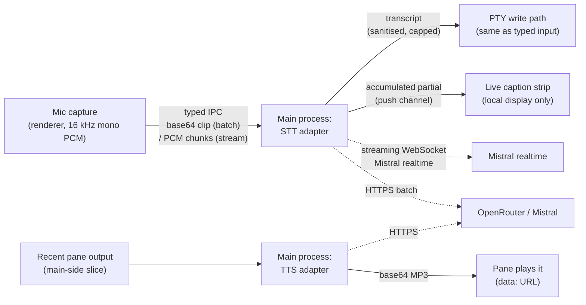

# Voice dictation and readback

Push-to-talk dictation and on-demand read-aloud for terminal tabs.

**Enable it first** — voice is off by default. Open **Settings → Voice** (under *Personal · this machine*), tick **Enable voice dictation**, and save; the Dictate/Read controls appear in terminal tab strips immediately, no restart needed. Until then no tab shows voice controls and nothing records, transmits, or speaks.

With voice enabled, two controls live in each tab strip's header, beside Find and Save, and appear once the tab has a live session:

- **Dictate** — click to start recording; a pulsing dot marks the recording state. With streaming on (the default), the words appear as a temporary caption under the tab strip while you speak; click again to stop and the final text is inserted into the tab it was recorded in, exactly as typed keystrokes would be. The OS microphone prompt fires once, on first use. If the tab's controls disappear mid-recording — you switch column, open the Dashboard band, or close the tab — the recording is cancelled and the microphone released immediately.
- **Read** — click to have the tab's recent output read aloud. The button reads "Stop" for the whole read and shows a spinner while the text-to-speech provider is still synthesizing; click it at any point to stop. Stopping during synthesis cancels the pending read, so no audio plays. It never speaks unprompted.

You never need the mouse: hold the **push-to-talk chord** (`Ctrl+Shift+Space` by default) to record, release to insert — see [Push-to-talk](#push-to-talk) below.

Both stay idle until clicked or chord-held. Nothing records unless Dictate is toggled on — and nothing is reachable at all while voice is disabled in Settings.

The live caption wraps across up to three visible rows, including long unbroken words.
Longer utterances scroll automatically to the newest words as partials arrive and when
the pane is resized; earlier words remain available by scrolling back. A short new
utterance starts at one row, and the caption disappears when dictation ends. Wrapping
is display-only: it does not insert line breaks into the terminal or change when the
final transcript is committed.

## How it works

- **Recording** happens in the renderer (echo cancellation + noise suppression on); **provider calls happen only in the main process** — the renderer never talks to the network, and key values are used only in the main process (a key entered in Settings is displayed back by the Settings prefill, the same shape as the dashboard's `apiKey`).
- **Streaming** (on by default): while recording, main opens one WebSocket to Mistral's realtime transcription endpoint and forwards the mic's PCM chunks as binary frames. The forming text comes back as accumulated partials and renders in a dashed live-caption strip under the tab strip — **local display only, never typed into the terminal**. On stop, the microphone is released first, then main finalises the stream and commits the final text once through the sanitised insert path.
- **Batch fallback**: a stream refusal or startup failure — no Mistral key, `voice.streaming` off, a handshake error — keeps the buffered clip for transcription on stop (OpenRouter chat first, Mistral multipart fallback). A mid-stream failure falls back in main on the audio it already received. If the stop IPC reply itself fails, condash reports the error without a second upload: main may already have inserted the transcript.
- Stream cancellation has one owner across stop and late startup replies. A failed cancellation delivery is retried once; if cleanup still cannot be confirmed, condash reports that failure and recommends restarting before further dictation rather than silently claiming the stream closed.
- The transcript is sanitised before insertion: control characters (a stray Ctrl-C, EOF), carriage returns, and ANSI escape sequences are stripped, and the text is capped at 4000 characters. An empty transcript is a visible no-op notice, never a silent write of nothing.
- The write goes through the same terminal-service path as typed input (`termWrite`), so multi-line transcripts submit per line, exactly as if typed.
- Read-aloud reads the tab's **recent output** — the same recent-scrollback slice the Dashboard summarizer uses. It is not a parsed "final answer": on a full-screen TUI tab it reads whatever the cleaned buffer holds.

## Push-to-talk

Hold **`Ctrl+Shift+Space`** (default) to record; release to insert — one recording state machine, two triggers, and the chord never hijacks anything outside the app (it is an in-app capture listener, not a system-wide shortcut: condash unfocused means the chord is free).

- A matched chord **starts on keydown** (with a live tab in the active column), or acquires an existing click recording without restarting it. Only that paired gesture **commits on keyup of its base key** — releasing Ctrl and Shift before Space still commits. Ordinary Space/letter typing never stops a click recording.
- Holding absorbs auto-repeat without acquiring another recording. The release belongs to the exact attempt captured on keydown: changing columns, cancelling or clicking stop and starting again cannot make an old release stop the new attempt.
- Set the field to **empty** in Settings → Voice to disable new push-to-talk gestures; any `parseShortcut`-grammar chord works (`Ctrl+Shift+D`, `F2`, …). An already-held gesture retains its original base key through shortcut changes, including empty-disable.
- Losing window focus, hiding the document or removing the keyboard listener cancels only the held gesture's recording without inserting text. Unrelated click recordings are unaffected. Release during pending microphone permission cancels that attempt and releases any late-acquired resources.
- It fires inside the xterm like screenshot-paste, so the chord never types into the shell; and clicking Dictate keeps keyboard focus in the terminal.

## Context bias

The words an ecosystem uses — app handles, project slugs, domain terms — are exactly what speech models misspell. **Settings → Voice → Context bias** takes one phrase per line (up to 100, the provider cap) and applies it on every documented surface:

| Path | Mechanism |
|---|---|
| OpenRouter chat (batch primary) | a glossary sentence in the transcription prompt |
| Mistral multipart (batch fallback) | native repeatable `context_bias` form fields |
| Mistral realtime (streaming) | none — bias is undocumented on the realtime endpoint |

The realtime gap is handled at commit time (the **final-text rule**): with a non-empty effective bias list, a streamed dictation's final text is re-checked through the Mistral batch path **with `context_bias`** (falling back to OpenRouter's glossary, then to the raw realtime text), using the audio the stream already carried. This adds provider work after stop and can incur a second transcription charge for the same audio; latency and pricing depend on the provider. An empty user-entered list does **not** disable this repass when automatic registry seeding makes the effective list non-empty. Only an empty effective list takes the single-transcription realtime path.

The effective list also includes the open conception's `repositories[]` app identity — handles, names, and aliases are seeded automatically and silently, so `#knoten` and `alicepeintures` come out spelled correctly without configuring anything.

## Providers and keys

OpenRouter is the first provider; Mistral is the fallback when OpenRouter has no key or fails. Endpoints and models (verified 2026-10-11):

| | Transcription | Speech |
|---|---|---|
| OpenRouter | `POST /api/v1/chat/completions` with an `input_audio` part, model `mistralai/voxtral-small-24b-2507` | `POST /api/v1/audio/speech`, model `mistralai/voxtral-mini-tts-2603`, voice `en_paul_neutral`, `response_format: mp3` |
| Mistral | `POST /v1/audio/transcriptions` (multipart), model `voxtral-mini-latest` | `POST /v1/audio/speech`, model `voxtral-mini-tts-2603`, `voice_id` required |

Keys resolve in this order:

1. `~/.config/agents/.env` (read-only) — `OPENROUTER_API_KEY` and `MISTRAL_API_KEY`. This is the default source; nothing to configure.
2. **Settings → Voice** (under *Personal · this machine*) — the manual fallback for machines without the env file. Keys are stored in the per-machine `settings.json` only, never in a tree's settings file, and are never logged; they are used only in the main process for provider calls (a settings-entered key is displayed back by this Settings prefill).

The Mistral TTS fallback additionally needs a **Mistral voice id** (`voice.mistralVoiceId`): Mistral's speech API has no anonymous preset voice. Without one the fallback is skipped with a clear message and read-aloud relies on OpenRouter alone. Transcription and OpenRouter speech work with just the env file.

The OpenRouter TTS voice id carries the language in its prefix — `en_paul_*`, `gb_jane_*`, `fr_marie_*` — pick another under Settings → Voice if you dictate in French (`fr_marie_neutral`).

## Privacy

> **Privacy:** capture begins only on an explicit dictation action. With streaming enabled, PCM chunks are sent to Mistral while you speak. Stop releases the microphone immediately, but buffered uploads, bias repasses, and provider processing can continue afterward to finish that dictation. There is no always-on capture; condash does not persist clips or audio. Partial text is displayed locally and never typed into the terminal; the final transcript is inserted only after stop.

- Voice must be enabled in Settings and dictation explicitly started by clicking Dictate or holding the chord; a stopped dictation can finish transcription after the control is released.
- The microphone is released on stop, on cancel, and the moment the tab's controls disappear (column switch, Dashboard band, tab close) — the session guarantees pinned by the lifecycle regression tests.
- Provider keys are used only in main for network calls and never logged. Environment keys stay in main; manually entered Settings keys have the existing Settings-prefill exception and are displayed back in the renderer.
- Read-aloud sends the tab's recent output **text** to the TTS provider when you click Read. As with the Dashboard: leave it off for tabs that display credentials you don't want transmitted.
- The mic permission handler is scoped to the app's own window contents — no embedded `<webview>` or other contents can open the microphone through condash. Every other permission class passes through untouched, keeping Electron's no-handler default (auto-approve) — denying them broke the Resources pane's clipboard read.

## Settings reference

Voice is **off by default**; the master switch is the first field in the section. Every field is optional; the full per-key reference lives in [Config files → Voice](../reference/config.md#voice).

| Setting | Default | Meaning |
|---|---|---|
| Enable voice dictation | off | Master switch. With it off, tab strips show no voice controls and the handlers refuse work with a typed disabled notice. |
| Stream dictation live | on | Realtime partials in the caption strip while speaking. Off restores batch-only dictation (transcribed on stop); a stream failure always falls back to batch regardless. Hidden while voice is disabled. |
| OpenRouter API key | — (env file) | Manual key when the env file is missing the entry. Hidden while voice is disabled. |
| Mistral API key | — (env file) | Fallback provider key (and the realtime streaming provider). Hidden while voice is disabled. |
| Transcription model | `mistralai/voxtral-small-24b-2507` | OpenRouter audio-input model. Hidden while voice is disabled. |
| Speech model | `mistralai/voxtral-mini-tts-2603` | TTS model on both providers. Hidden while voice is disabled. |
| Speech voice | `en_paul_neutral` | Voxtral voice id (language prefix: `en_paul_*` / `gb_jane_*` / `fr_marie_*`). Hidden while voice is disabled. |
| Mistral voice id | — | Enables the Mistral TTS fallback; unset skips it. Hidden while voice is disabled. |
| Context bias | — (empty) | One phrase per line, up to 100. Vocabulary spelled exactly on the batch surfaces; non-empty routes a streamed stop through a bias-corrected batch repass. The conception's app handles are added automatically. Hidden while voice is disabled. |
| Push-to-talk shortcut | `Ctrl+Shift+Space` | Hold-to-dictate chord. Empty disables push-to-talk. Hidden while voice is disabled. |
